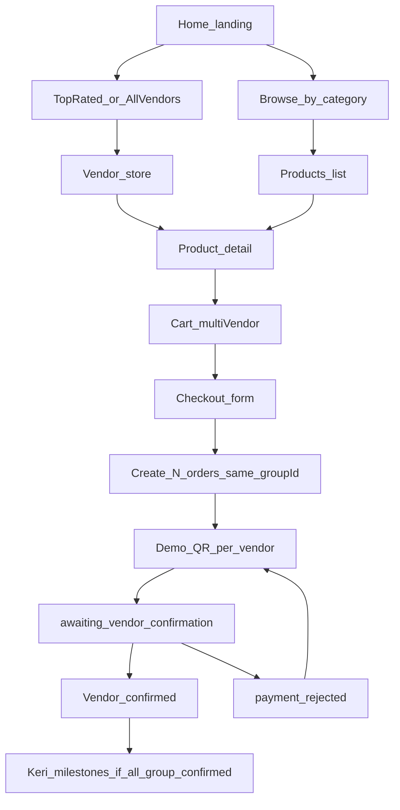
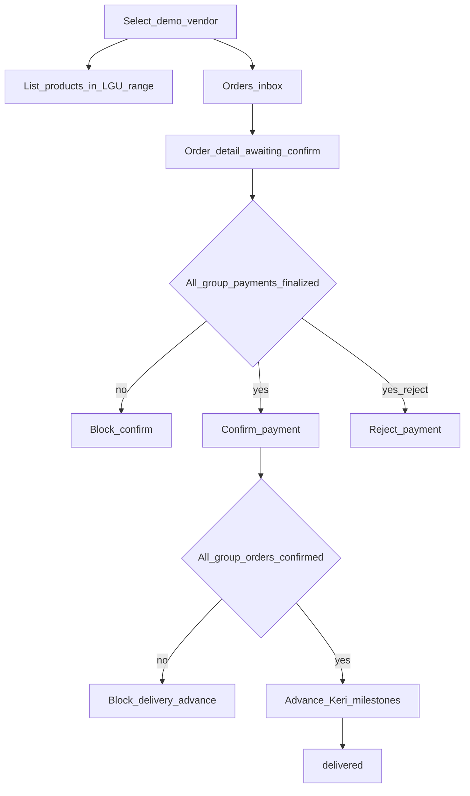
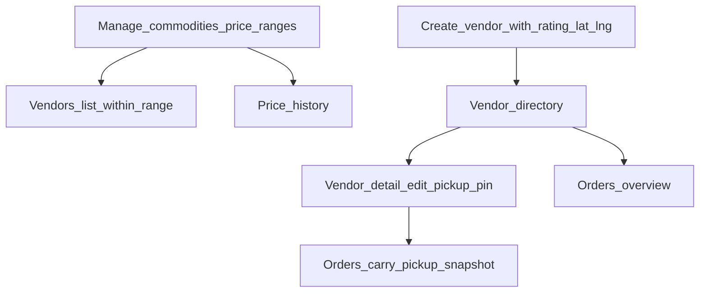
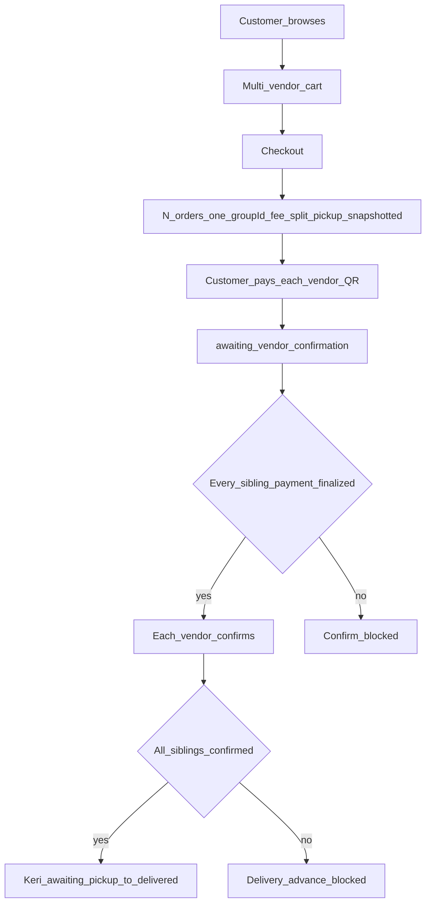

# Palengke mo, Keri ko — Module Flow Brief

**Purpose:** Locked source-of-truth brief for stakeholder documentation. Do not invent features beyond this document.

**Product:** `Palengke mo, Keri ko` — frontend-only marketplace prototype inspired by Parañaque palengke + Keri delivery.

**Stack / runtime notes:**
- React + Vite + TypeScript; HashRouter (GitHub Pages–friendly)
- Zustand stores persisted in `localStorage` under prefix `paranaque-palengke-v8`
- Three portals switched in-app (no real auth): Customer storefront, Vendor portal, LGU Admin
- Demo payments via simulated QR / QRPH placeholder (no real money movement)
- Tumawad / offer negotiation exists in code but is **hidden** (`FEATURE_TAWAD_ENABLED = false`)

**Brand:**
- Name: Palengke mo, Keri ko
- Tagline: Preskong Pamalengke, Mas Madaling Mamili.

---

## 1. Actors & portals

| Actor | Portal path | Role |
|--------|-------------|------|
| Customer (User) | `/customer` | Browse vendors/products, cart, checkout, pay, track orders, chat |
| Vendor | `/vendor` | Manage store profile & listings, confirm/reject payments, advance Keri delivery, chat |
| LGU Admin | `/admin` | Commodities & price ranges, price history, vendor directory (rating + pickup lat/lng), orders overview |

Demo vendor selection uses an in-portal session switcher (not real login).

---

## 2. Customer module

### Screens / routes
- Home `/customer` — full-viewport landing; top-rated vendors (3); categories
- All vendors `/customer/vendors` — available vendors sorted by rating
- Vendor store `/customer/stores/:vendorId`
- Products browse `/customer/products` (+ category / search query)
- Product detail `/customer/products/:productId`
- Cart `/customer/cart`
- Checkout `/customer/checkout`
- Payment (single) `/customer/payment/:orderId`
- Payment group `/customer/payment/group/:groupId` — multi-vendor checkout
- Orders list `/customer/orders`
- Order detail `/customer/orders/:orderId`
- Chat `/customer/chat` (+ `/customer/chat/:threadId`)
- Offers `/customer/offers` — **not reachable while tawad is disabled**

### Happy-path steps
1. Land on home (hero only in first viewport); scroll to Meet Our Vendors (top-rated) or browse by category.
2. Open a vendor store and/or product; add items to cart (multi-vendor cart allowed).
3. Cart shows line prices (vendor-declared), subtotal, and flat **₱100** Keri delivery fee (shown split per vendor when multiple vendors).
4. Checkout collects customer name, contact, optional notes.
5. System creates **one Order per vendor** in the cart, all sharing one `checkoutGroupId`.
6. Each order starts as `pending_payment`, with `pickupLat` / `pickupLng` snapshotted from that vendor’s store coordinates.
7. Customer pays each vendor order via demo QR (group page if multiple). Submit → `awaiting_vendor_confirmation`.
8. After vendor(s) confirm, customer sees Keri delivery milestones on order detail (only when **all** orders in the group are `confirmed`).
9. Optional: chat with a vendor about stock / cut-off / pickup.

### Customer rules & gates
- Vendor past daily cut-off (`cutoffTime`) or unavailable → cannot accept new orders (store/product add blocked; checkout fails if vendor closed).
- Pricing display: vendor price + LGU range disclaimer.
- Quantity is a unit count for the product’s unit (`kg` or `piece` / pcs); there is **no separate kilos field** and **no 25 kg cart cap** in the current build.
- Multi-vendor: N orders, fee split across vendors (remainder cents applied to first vendor).
- Payment rejected → customer may resubmit demo payment (`payment_rejected` → `awaiting_vendor_confirmation`).

### Customer mermaid

---

## 3. Vendor module

### Screens / routes
- Dashboard `/vendor`
- Orders list `/vendor/orders`
- Order detail `/vendor/orders/:orderId`
- Products / stock `/vendor/products`
- Store profile `/vendor/store` — name, description, location text, hours, availability (**not** lat/lng; admin owns pickup pin)
- Chat `/vendor/chat`
- Offers `/vendor/offers` — hidden while tawad disabled

### Happy-path steps
1. Select active demo vendor in portal.
2. List products from LGU commodities; set `vendorPrice` **inside** commodity `priceMin`–`priceMax`; choose unit `kg` or `piece`; set stock.
3. Receive orders in `awaiting_vendor_confirmation` after customer submits demo payment.
4. Confirm payment **only if every sibling order in the same `checkoutGroupId` has reached a “paid enough” state** (`awaiting_vendor_confirmation`, `confirmed`, or `payment_rejected` — i.e. customer has finalized payment attempt for all vendors). On confirm → order `confirmed` + `deliveryStatus = awaiting_pickup`.
5. Or reject payment → `payment_rejected` (customer can retry).
6. Advance Keri delivery **only if** this order is `confirmed` **and** all siblings in the group are `confirmed`:  
   `awaiting_pickup` → `out_for_delivery` → `delivered`.
7. Order detail shows Keri pickup pin snapshot (`pickupLat`, `pickupLng`) for this store.
8. Chat with customers.

### Vendor rules & gates
- Cannot confirm own order until all vendors in the checkout group have customer payment finalized (gate message: customer must finalize payment for all vendors).
- Cannot advance delivery until all vendors in the group have confirmed.
- Store profile does not edit rating or lat/lng (LGU admin responsibility).
- Cut-off / opensAt control whether the stall accepts new customer orders.

### Vendor mermaid

---

## 4. LGU Admin module

### Screens / routes
- Dashboard `/admin`
- Commodities `/admin/commodities` — create/edit LGU commodities (category, unit hint, `priceMin`/`priceMax`, image, active flag)
- Price history `/admin/price-history` — audit of range changes
- Vendors `/admin/vendors` — directory + **Create vendor**
- Vendor detail `/admin/vendors/:vendorId` — products snapshot; **Keri pickup pin** (rating, lat, lng)
- Orders `/admin/orders` — overview of marketplace orders
- Offers `/admin/offers` — hidden while tawad disabled

### Happy-path steps
1. Define / update commodities and allowed price ranges (guidance for vendors).
2. Register vendors (name, description, location text, categories, image, hours, QR label, availability, **rating**, **lat**, **lng**).
3. On vendor detail, adjust rating and store pickup coordinates used for Keri.
4. Monitor orders across vendors (read-oriented overview in demo).

### Admin rules
- Vendor-declared prices must stay within LGU range (enforced on vendor product forms).
- Pickup coordinates are **per store (vendor)**, not per market/branch entity.
- Rating (1–5) drives customer home “top rated” sort.
- When an order is placed, pickup lat/lng are **copied onto the order** (snapshot at checkout).

### LGU mermaid

---

## 5. End-to-end order lifecycle (shared state machine)

### Payment / confirmation statuses (`Order.status`)

| Status | Meaning |
|--------|---------|
| `pending_payment` | Order created; customer must complete demo QR |
| `awaiting_vendor_confirmation` | Customer submitted demo payment; vendor must verify |
| `confirmed` | Vendor confirmed; delivery milestones may proceed (subject to group gate) |
| `payment_rejected` | Vendor rejected; customer may resubmit |

**Allowed transitions:**
- `pending_payment` → `awaiting_vendor_confirmation`
- `awaiting_vendor_confirmation` → `confirmed` | `payment_rejected`
- `payment_rejected` → `awaiting_vendor_confirmation`
- `confirmed` → (none for payment status)

### Keri delivery statuses (`Order.deliveryStatus`) — after confirm
1. `awaiting_pickup` — Preparing for Keri  
2. `out_for_delivery` — Out for delivery  
3. `delivered` — Delivered  

Set to `awaiting_pickup` when payment is confirmed. Advanced by vendor under group-all-confirmed gate.

### Checkout economics
- Flat delivery fee: **₱100** (`DELIVERY_FEE`) included in payment totals.
- Multi-vendor: fee split evenly; rounding remainder on first vendor order.
- One `checkoutGroupId` ties sibling orders from a single checkout.

### End-to-end mermaid

---

## 6. Cross-module handoffs (who waits on whom)

| Handoff | Waiting party | Depends on |
|---------|---------------|------------|
| Catalog prices | Vendor | LGU commodity ranges |
| Top-rated home list | Customer | Admin-set vendor `rating` |
| Keri pickup pin on order | Customer / Vendor / Rider-facing UI | Admin-set vendor `lat`/`lng` at checkout time |
| Confirm payment | Vendor | Customer finished payment flow for **all** vendors in group |
| Show / advance Keri milestones | Customer & Vendor | **All** group orders `confirmed` |
| Resubmit payment | Customer | Vendor chose `payment_rejected` |
| Chat | Customer ↔ Vendor | Shared thread per vendor–customer pair (demo labels) |

---

## 7. Out of scope / demo limitations (explicit)

- No real authentication, KYC, or role permissions server-side
- No real QRPH / bank settlement; payment is simulated
- No live Keri rider app integration (coords are shown as pickup pin on orders)
- No separate “Branches / palengke market” entity — location is per vendor store
- No weight / 25 kg order limit implemented
- Tumawad (offers) UI disabled via feature flag (code retained)
- No production backend; data is browser `localStorage`
- Prices and vendors are illustrative / demo only (disclaimer in UI)

---

## 8. Key constants (as implemented)

- `DELIVERY_FEE = 100` (PHP)
- `HOME_TOP_RATED_VENDOR_COUNT = 3`
- `FEATURE_TAWAD_ENABLED = false`
- `STORAGE_PREFIX = paranaque-palengke-v8`
- Vendor stock units allowed in UI: `kg` | `piece`

---

*End of brief. Generated from the Parañaque Palengke codebase for PDF packaging only.*
